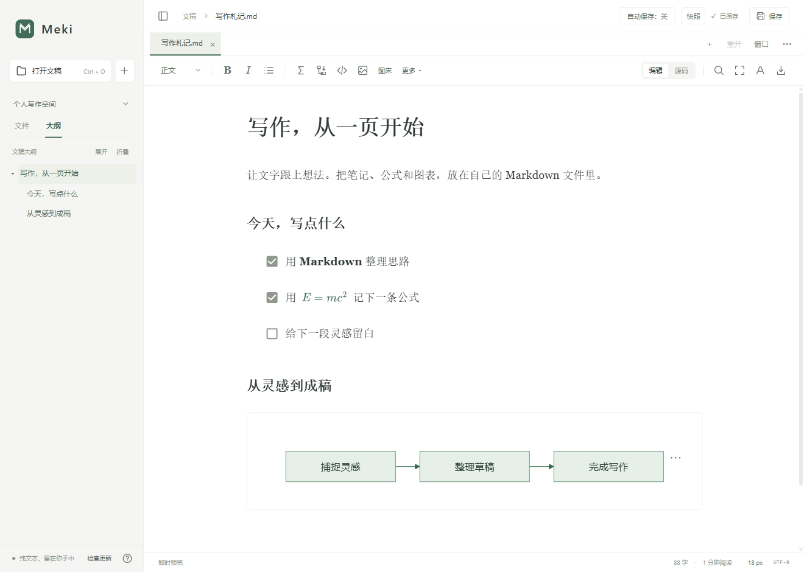

  

<h1 align="center">Meki</h1>

  <strong>你的文字，留在本地。</strong> 
  适用于 Windows 与 macOS 的 Markdown 编辑器 
  即时预览 · 离线公式与图表 · 自由分栏

  <a href="#写作所需">功能亮点</a> ·
  <a href="#获取-meki">获取 Meki</a> ·
  <a href="docs/README.md">文档</a> ·
  <a href="docs/releases/1.0.0.md">版本说明</a>

<picture>
  <source media="(prefers-color-scheme: dark)" srcset="docs/images/meki-night.png">
  
</picture>

从一页笔记，到一篇完整的文章。

## 写作所需

- **流畅写作** — 即时预览与源码编辑随时切换，支持表格、任务列表、脚注、目录和代码高亮。

- **公式图表** — MathJax 公式与 Mermaid 图表随应用提供，离线也能写公式、画流程图。

- **自由布局** — 多标签、独立窗口、拖动分栏与块操作，配合大纲、查找替换和工作区搜索。

- **保存恢复** — 可开启自动保存，支持草稿恢复、手动与自动快照、本地版本历史。

- **图片管理** — 粘贴、拖放、调整尺寸、整理本地附件，也可连接 PicGo 上传。

- **外观导出** — 中英文界面、三套主题与正文外观设置；导出 HTML、PDF、PNG，安装 Pandoc 后还可导出 Word 与 EPUB。

## 获取 Meki

当前为 **1.0.0 源码候选版**，安装包尚未发布。后续的 Windows EXE 安装器与 macOS 通用 DMG 将在 [GitHub Releases](https://github.com/Irk2wd/Meki/releases) 提供。

## 文件属于你

Meki 直接读写本地 Markdown 文件，无需账户，没有云同步或遥测。设置、草稿、快照与版本历史也保存在本机。

写作、公式和图表渲染可离线使用。检查更新、加载网络图片、打开外部链接、PicGo 上传，以及启用拼写检查后的词典下载会按需联网。

## 继续了解

[打开文档 →](docs/README.md) 使用说明、源码运行、开发验证、Markdown 兼容性与更新维护。

---

项目自有代码、文档和资源采用 [MIT 许可证](LICENSE)。第三方组件保留各自条款，详见 [组件声明](THIRD_PARTY_NOTICES.txt) 与 [许可文本](licenses/README.md)。
